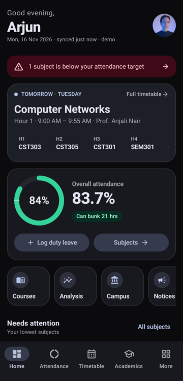
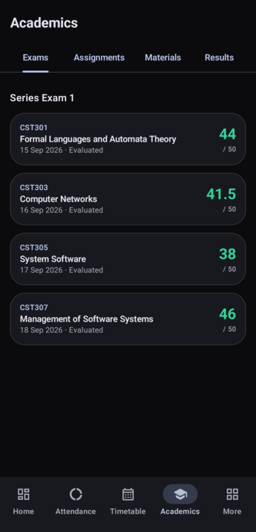
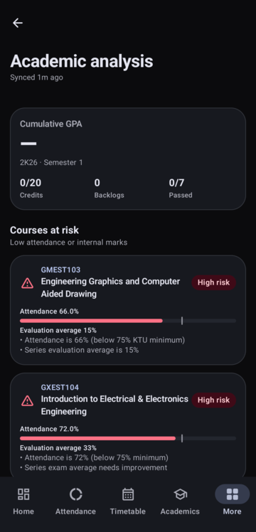

  

<h1 align="center">ETBridge</h1>

  <b>A faster, friendlier way to use the ETLab student portal.</b> 
  Open-source web and Android apps for students of colleges that use ETLab —
  with bunk-margin maths, duty-leave projection, a live timetable and offline access.

  <a href="https://etbridge.nimd.me"><b>🌐 Open the web app</b></a>
  &nbsp;·&nbsp;
  <a href="https://github.com/ET-Bridge/android/releases/latest"><b>📱 Download for Android</b></a>
  &nbsp;·&nbsp;
  <a href="https://etbridge.nimd.me/docs">📖 Docs</a>

  
  
  

Android app in demo mode — all names are fictional.

---

### Apps

| | Platform | Get it | Source |
|---|---|---|---|
| 🌐 | **Web app / PWA** — works in any browser, installable on Android and iOS | [etbridge.nimd.me](https://etbridge.nimd.me) | [ET-Bridge/webapp](https://github.com/ET-Bridge/webapp) |
| 📱 | **Android app** — native Kotlin + Jetpack Compose, with widgets and notifications | [Latest APK](https://github.com/ET-Bridge/android/releases/latest) | [ET-Bridge/android](https://github.com/ET-Bridge/android) |

### Why ETBridge?

ETLab's official app is slow to start, buries key numbers behind several menus and is unusable on a
patchy classroom connection. ETBridge puts what students check every day up front:

- **Attendance that answers the real question** — exactly how many hours you can skip, or must attend,
  to stay above 75% (per subject and overall)
- **Duty-leave projection** — log approved duty leaves and see your attendance as it will be once
  faculty enter them; ETBridge reconciles them automatically
- **Live timetable** — the class happening now, what's next, substitutions and holidays
- **Marks & assignments** — series exams with class averages, assignment deadlines and downloads
- Courses and syllabus coverage, academic analysis, activity points, fees, notices and circulars
- **Offline-first** — the last sync stays available without a connection

### Privacy

- There is **no ETBridge account and no ETBridge database.** You sign in with your normal ETLab
  credentials, and your data is cached only on your own device.
- The **Android app** talks to ETLab's official student API directly.
- The **web app** runs in your browser; because browsers block cross-site requests, it reaches ETLab
  through a small stateless edge function that forwards requests and stores nothing.
- Both apps are open source, so anyone can audit exactly what they do.

### Supported colleges

Any institution that uses the ETLab student portal. Your college code is the subdomain of your portal
— for example `gcek` for `gcek.etlab.app`. Both apps include a searchable college list.

### Contributing

Bug reports, feature ideas and pull requests are welcome in the repository for the app concerned.
Please use demo mode for screenshots and never post real student data, credentials or tokens in
issues.

---

ETBridge is an independent, community-built project created by <a href="https://nimd.me">NiMD</a>.
It is not affiliated with, endorsed by or connected to ETLab or Etuwa Concepts. All product names and
trademarks belong to their respective owners. Released under the MIT License.

